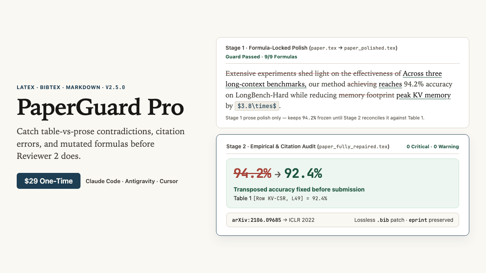
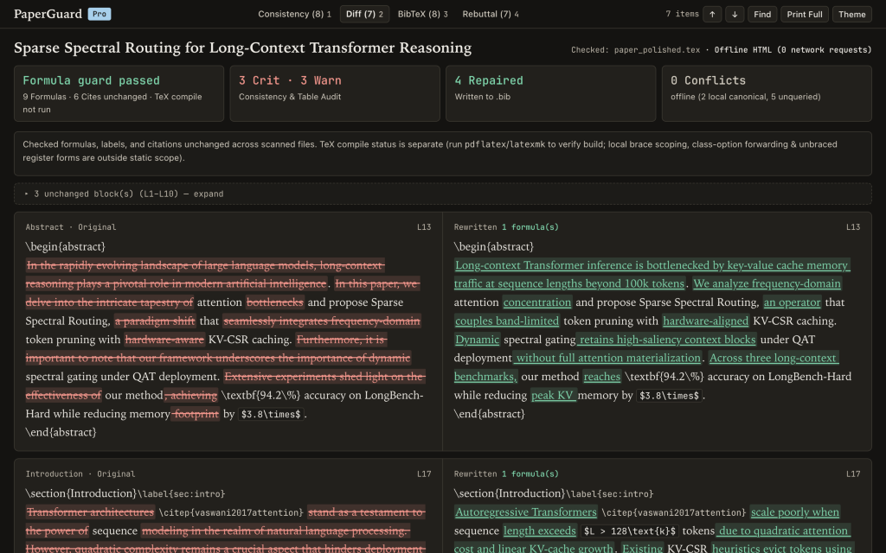

# PaperGuard Lite

**Audit `.bib` citation conflicts, dangling `\cite{}` / `[@key]` references, and stock LLM prose clichés in LaTeX & Markdown manuscripts — read-only, zero pip dependencies.**

🌐 **Website & Interactive Demo**: [https://paperguard-app.github.io/](https://paperguard-app.github.io/) · ⬇️ **[Download Free Mac/Win App (ZIP)](https://github.com/paperguard-app/paperguard/releases/latest/download/PaperGuard-Lite-v2.5.0.zip)** · ⚡ **[Unlock PaperGuard Pro ($29)](https://zhangx2.gumroad.com/l/paperguard-pro)**



[](LICENSE)
[](#quickstart)
[](#transparent-data-paths)

---

## Why Run PaperGuard Before Submission

1. **Catch Citation Mashups & Retractions Without False Quarantines**: Cross-checks DOIs and identifiers across **Crossref, DataCite (`10.48550/arXiv.*`), OpenAlex (CC0 retraction & errata guard), DBLP, and arXiv**, flagging retracted papers, DOI-title mismatches, and unresolved citation keys across `.tex` (including `\input` subfiles and optional `--aux`) and Markdown (`[@key]` + optional `pandoc` AST).
2. **Spot High-Density LLM Clichés Without Touching Math**: Uses a vendored MIT `pylatexenc 2.11` LaTeX AST engine to mask comments, `\verb`/`\lstinline`/`\mintinline`/`verbatim`, inline/multiline math (including `\$`), and Markdown code fences before highlighting stock phrases (*"delve into"*, *"intricate tapestry"*, *"testament to"*).
3. **Zero `pip install` Dependencies**: Python 3.11+ standard library + vendored pure-Python MIT `pylatexenc 2.11` (`0` `pip install` packages; see [THIRD_PARTY_NOTICES.md](THIRD_PARTY_NOTICES.md)) with WCAG AA accessible **Archival Paper & Obsidian Ink** HTML diagnostics.

---

## Transparent Data Paths

- **Offline CLI & HTML Cockpit (Default for Renderer)**: `scan_ai_slop_lite.py`, `audit_bib_lite.py --offline`, and `render_audit_ui.py` (offline by default even when given `--bib`) run 100% on local disk with **0 outbound network requests**.
- **Online Bibliography Check (Opt-In)**: Running `audit_bib_lite.py` without `--offline` (or `render_audit_ui.py --bib ... --online`) sends **only** `.bib` identifiers/titles/authors to public Crossref, DataCite, OpenAlex, DBLP, and arXiv endpoints (never manuscript body prose).
- **IDE Agent Prompts**: Invoking `SKILL.md` through Antigravity, Claude Code, or Cursor uses your configured IDE model provider.

---

## Quickstart

### Option 1: Double-Click Local App (macOS & Windows — No Terminal Needed)

1. **macOS**: Double-click `Start-PaperGuard-Mac.command` *(first time on macOS if Gatekeeper prompts: open **System Settings → Privacy & Security → Open Anyway**, or run `python3 paperguard_app.py` in Terminal)*.
2. **Windows**: Double-click `Start-PaperGuard-Win.bat`.
3. Drag & drop your `.tex` / `.md` and `.bib` files (or click **Try Built-in Demo**), view the offline HTML report, or use the built-in **One-Click IDE Installer** tab.

### Option 2: Install into Antigravity, Claude Code, or Cursor (CLI)

```bash
git clone https://github.com/paperguard-app/paperguard.git
cd paperguard

# macOS / Linux / WSL:
./install.sh --project /path/to/your/paper-repo

# Windows PowerShell:
.\install.ps1 -Project C:\path\to\your\paper-repo
```

### Option 3: Run Single-Pass Standalone CLI + Accessible HTML Cockpit

```bash
# 1a. Pure local air-gapped run (0 network calls):
python3 paperguard-lite/scripts/render_audit_ui.py -m paper.tex --bib references.bib --out audit.html --open

# 1b. Online multi-registrar verification + cached HTML cockpit (0 duplicate queries):
python3 paperguard-lite/scripts/audit_bib_lite.py references.bib -m paper.tex --json .pg_bib.json
python3 paperguard-lite/scripts/scan_ai_slop_lite.py paper.tex --json .pg_slop.json
python3 paperguard-lite/scripts/render_audit_ui.py -m paper.tex --bib-json .pg_bib.json --slop-json .pg_slop.json --out audit.html --open
```

---

## PaperGuard Lite (MIT) vs. PaperGuard Pro ($29 One-Time)

| Capability | PaperGuard Lite (Free) | PaperGuard Pro ($29 One-Time) |
| :--- | :---: | :---: |
| **Zero-Dependency Python 3.11+ Stdlib & Offline HTML** | Yes | **Yes** |
| **Crossref + DataCite + arXiv Multi-Registrar Verification** | Read-Only | **Lossless Span Patching (`fix_bib_pro.py`)** |
| **Byte-Identical Preservation of `@string`, `@preamble` & Macros** | — | **Guaranteed on Untouched Fields** |
| **Identity-Checked arXiv -> NeurIPS/ICLR Upgrades** | Candidate Note | **Automated (Retains `eprint` Provenance)** |
| **Stateful LaTeX Math, Command, Arg & Order Guard (`latex_guard.py`)** | — | **Checked Formulas, Labels & Cites Unchanged + Word-Diff** |
| **Cell-Bound Multi-Table Numeric Contradiction Linter** | — | **Pinpoints `Table [Row, Col]` vs Prose (Abs, Rel %, pp)** |
| **Evidence-Bound Style Bank (156 Pairs) & Rebuttal Playbook** | — | **Included** |
| **4-Lens Studio Workbench (390px–1440px, Context-Folded)** | Diagnostic View | **Full 4-Lens Pro Workbench** |

*(Note: `latex_guard.py` confirms checked formulas, labels, and citations are unchanged; TeX compilation is verified separately with `pdflatex`/`latexmk`, and local brace-scoped macro/register redefinitions, `\documentclass[opts]` option forwarding, and unbraced register forms are outside static scope.)*

**[Unlock PaperGuard Pro ($29 one-time download) →](https://zhangx2.gumroad.com/l/paperguard-pro)**



> *Screenshot shows Stage-1 Studio verification (`paper.tex` → `paper_polished.tex`, Obsidian Ink theme) after writing the repaired bibliography via `fix_bib_pro.py --out references.fixed.bib` (`4 Repaired · Written to .bib`, vs `4 Previewed` in read-only `--bib` dry-run mode). Resolving the remaining Stage-2 table/ref contradictions in `paper_fully_repaired.tex` yields `0 Critical / 0 Warnings`.*

---

## License

MIT License. See [LICENSE](LICENSE).
